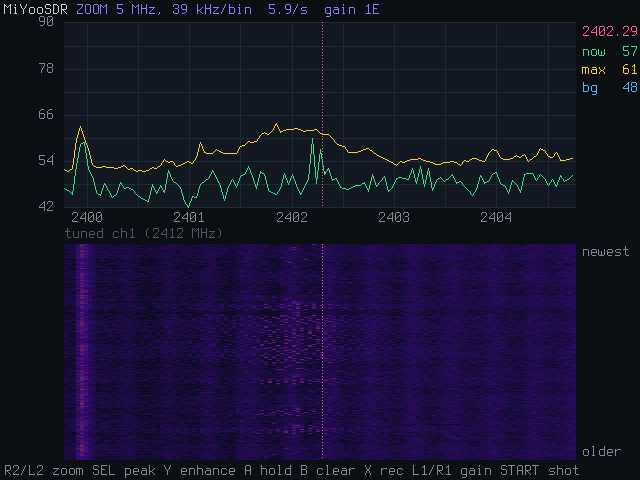

# MiYooSDR

Experimental **2.4 GHz energy visualization, Wi-Fi packet capture, and saved
capture review** for the **Miyoo Mini Plus**, using its built-in RTL8188FU radio.
No external receiver is needed for the supported live measurements and captures.

## Current state

The current published version is **[0.7.0 (experimental)](https://github.com/uncannyowly/MiYooSDR/releases/tag/v0.7.0)**.
There are three separate workflows:

| Workflow | Available now | How to use it |
| --- | --- | --- |
| Live spectrum view | Sequential PSD power measurements, waterfall, zoom, relative channel-activity bars, persistence display, a single-frequency scope, audio tone, CSV recording and review | Launch MiYooSDR from Onion's Apps list |
| Wi-Fi packet capture | 802.11 frames with driver-provided radiotap metadata, saved as PCAP using the stock driver | Run the separate `research/monitor-capture.sh` script over SSH |
| Saved playback | PCAPs: packet-count timeline, frame list, header fields and available PHY metadata. Spectrum CSVs: spectrum and waterfall replay | The **MiYooSDR Replay** app, SELECT + START in live mode, or `--replay` |

Spectrum recording with **X** saves power measurements as CSV. It does not start
packet capture. The recording browser opens saved files; there is currently no
in-app button to start the command-line packet capture tool.

**Raw I/Q capture has not been demonstrated.** The PSD viewer measures power one
frequency bin at a time; a waterfall row is assembled from measurements taken at
different times. It does not classify or decode Wi-Fi, Bluetooth, or Zigbee from
those measurements. The channel names shown at the cursor are frequency
references. Packet playback reads already captured 802.11 headers and metadata.
No CSI extraction, payload decryption, frame injection, or over-the-air replay is
implemented. Normal Wi-Fi operation before and after capture still transmits.

### What has been verified

On one Miyoo Mini Plus running OnionOS, Linux **4.9.84**, and stock driver
**`v5.7.4.2_36687.20200421`**:

- An eight-second monitor capture saved **3,647 frames**, including 202 beacons,
  on channel 11. Independent host analysis verified all saved frame checksums;
  the packet socket reported zero drops. This does not prove every over-the-air
  frame was received. Managed Wi-Fi recovered after that experiment.
- Offline playback loaded that capture and rendered a screenshot on the Miyoo
  that matched the host rendering byte for byte, while Wi-Fi stayed connected.
- Version 0.6.0 on the same Mini Plus: live sweeps through full band, zoom and
  back with no I/O errors or frozen readings, at about 5 sweeps per second full
  band and 15 at the 20 MHz zoom. A replay started over SSH paused Onion's menu,
  took the buttons, and handed both back with the screen restored byte for byte.
  PCAP and spectrum CSV replay screenshots matched the host renders byte for byte.
- Version 0.7.0: the scope read about 3,100 times a second at 2426 MHz (Bluetooth
  LE advertising channel 38) and caught bursts there as short as one reading. The
  persistence panel, scope replay and SELECT combinations worked on the device.
- Automated tests cover PCAP parsing, malformed files, record limits, offline
  rendering, CSV recordings, sweep and input handling, and the launcher and
  capture-script behavior. Hardware validation does not yet cover every
  interactive control or other driver/OS versions.

The stock driver can report incorrect rates and suspect signal values. No
replacement kernel or driver has been built or loaded for these features. See
the [research notes](docs/driver-research.md) for the evidence and limitations.



## Requirements

- Live spectrum and packet capture require a **Miyoo Mini Plus** with its
  RTL8188FU radio and **OnionOS**. The plain Mini has no built-in Wi-Fi radio.
- The tested stock driver version is listed above; compatibility with other
  drivers is unverified. Spectrum mode needs the vendor driver's register proc
  entries; packet capture uses Wireless Extensions monitor mode.
- Offline playback does not access Wi-Fi, but has only been tested on the Mini
  Plus. Interactive display uses the Linux framebuffer and input device.

## Install

1. Download `miyoosdr-<version>.zip` from [Releases](https://github.com/uncannyowly/MiYooSDR/releases).
2. Extract it to the root of your SD card. It drops in as `App/MiYooSDR` and
   `App/MiYooSDR Replay`.
3. On the Mini Plus, open **MiYooSDR** from Onion's **Apps** list for the live
   spectrum, or **MiYooSDR Replay** to play saved recordings and captures.

Live spectrum mode takes Wi-Fi offline so nothing retunes the radio mid-sweep.
On exit, the launcher attempts to restore Onion's networking. MiYooSDR Replay,
`launch.sh --replay FILE` and `launch.sh --review` leave Wi-Fi and audio alone:
the launcher asks the app whether its options need the radio, and refuses
mistyped options before anything changes. Opening review from a running
live-spectrum session keeps that session's Wi-Fi-off state until exit.

Started over SSH while Onion's menu is on screen, MiYooSDR pauses the menu and
takes the buttons for itself, then hands both back on exit with the screen as it
was.

The ZIP includes both binaries, scripts, and documentation. It contains no sample
recordings or captured network traffic. Create a capture or copy in a compatible
file before using packet playback. Existing recordings and settings are preserved
when extracting the ZIP over an installed copy.

## Live spectrum controls

| Button | Action |
| --- | --- |
| R2 / L2 | Zoom in / out (full band, then 20, 10, 5 MHz around the cursor); R2 at 5 MHz opens the [scope](#scope-mode) |
| D-pad Left / Right | Move the cursor (pans the view at the edges when zoomed) |
| SELECT (tap) | Jump the cursor to the strongest peak |
| SELECT + Y | Cycle the spectrum view: line, filled, filled with Wi-Fi band shading |
| SELECT + A | Cycle the colour palette (Ember, Spectrum, Ice, Matrix) |
| SELECT + B | Cycle the lower panel: waterfall, relative channel-activity bars, persistence |
| SELECT + X | Signal-to-sound: a tone whose pitch follows the level under the cursor |
| SELECT + START | Browse saved spectrum CSVs and Wi-Fi PCAPs |
| Y | Enhance: show dB above the slow background instead of absolute level |
| A | Show or hide the max-hold trace |
| B | Clear the hold, average, waterfall and burst count |
| X | Start / stop recording to `App/MiYooSDR/rec/*.csv` |
| L1 / R1 | Gain down / up |
| D-pad Up / Down | Shift the level range |
| START | Save a screenshot (`App/MiYooSDR/shots/sdr-<date>-<time>.png`) |
| MENU | Quit |

Holding a button repeats only on the d-pad and L1 / R1, so toggles such as X and A
act once per press. Screenshots are compressed PNGs of about 25 to 55 KB.

Levels are **uncalibrated** relative dB, not measured dBm. The nominal full-band
view covers roughly 2402 to 2482 MHz in 256 bins. Zoomed views use larger on-chip
FFTs on a single channel, down to about 39 kHz nominal bin spacing. Each bin is
labelled with the centre frequency of its FFT tone. This is not a calibrated
frequency-resolution or receiver-sensitivity specification.

## Reading the screen

- **Frequency references:** the cursor panel shows frequency, current level,
  max hold and background, plus the BLE, Wi-Fi and Zigbee channel numbers that
  correspond to that frequency. Yellow ticks mark BLE advertising channels 37,
  38 and 39. These labels do not identify the source or protocol of a signal.
- **BURSTS:** counts sampled energy excursions near the cursor (its bin and two
  neighbours). An event starts above 8 dB over the adaptive background and ends
  below 5 dB. Its count, spacing and duration are limited by sweep timing; short
  events can be missed or merged. They are not individual packet counts or exact
  transmission durations. Typical observed sweep times are about 0.2 s full-band
  and 0.05–0.15 s zoomed, depending on mode. B clears the count; moving the cursor
  resets it.
- **Channel occupancy view:** the bars show relative energy above the adaptive
  background across overlapping Wi-Fi channel windows. They update in full-band
  mode and remain unchanged while zoomed. They are not measured airtime or a
  guarantee that a suggested channel is clear.
- **Persistence view:** how often each level has shown up at each frequency over
  roughly the last 30 sweeps, brighter for more often. A steady carrier is a bright
  line, a busy Wi-Fi channel a cloud above the floor, and rare hits single dots
  that a live trace would miss. Changing the level range starts it over.
- **Signal-to-sound:** the tone follows the relative level at the cursor. It is
  an audio aid, not a validated direction-finding or distance measurement.
- **Remembered:** palette, view style, lower panel, enhance, max hold, zoom and the
  cursor are saved to `App/MiYooSDR/settings.txt` when you quit and restored on the
  next start. Delete the file to start fresh.

## Scope mode

The scope reads one frequency over and over, about 3,000 times a second, instead
of sweeping. Sweeps come back to a frequency only every 40 to 200 ms; the scope
shows the shape and timing of short bursts, such as a remote's button press. Open
it with **R2 at the 5 MHz zoom** (it reads the frequency under the cursor), or start
on it with `./launch.sh --scope 2402`.

Each reading covers a 312.5 kHz wide FFT bin, the one nearest the frequency asked
for. The upper panel is a rolling trace of the last second or so. A **hit** is a
reading over the yellow dotted line, well above the background (blue dotted line);
both adapt to the noise between bursts. Hits less than 50 ms apart make one
**burst**. The lower panel shows the last burst stretched out with a millisecond
axis, and the right column counts bursts, the time since the last one, the time
between bursts, and the hits in the last one.

| Button in the scope | Action |
| --- | --- |
| Left / Right | Move to the next 312.5 kHz bin down / up |
| SELECT + Left / Right | Shorten / lengthen the trace (0.05 to 10 s) |
| Up / Down | Shift the level range |
| L1 / R1 | Gain down / up |
| A | Hold the screen / run again |
| X | Start / stop recording to `App/MiYooSDR/rec/scope-<date>-<time>.csv` |
| B | Clear the burst count |
| SELECT + X / SELECT + A | Signal-to-sound / palette |
| START | Save a screenshot |
| L2 | Back to the 5 MHz zoom |
| MENU | Quit |

Readings are about 0.3 ms apart, so a packet shorter than that can fall between
two readings, and burst lengths and spacing are accurate to about one reading.
Scope recordings hold one reading per line (seconds, gain, dB times ten) and play
back in the recording browser, marked `[SCOP]`, on the scope's own screen.

## Playing back captures

Open the recording browser with the **MiYooSDR Replay** app, or with
**SELECT + START** during live spectrum. It lists `.csv` and `.pcap` files from
`App/MiYooSDR/rec/` and `App/MiYooSDR/research/`, newest first, marked `[CSV ]`,
`[SCOP]` for scope recordings or `[PCAP]`, including the
`research/stock-monitor.pcap` produced by the packet capture script. Copy other
compatible captures into either directory. Use Up / Down to select a file, Left /
Right to page, A to open it, and B to return.

PCAP playback shows management/control/data frame counts over time, a scrolling
frame list, and the selected frame's type, transmitter/receiver addresses,
sequence, length, flags, and available rate, signal and frequency metadata.
Playback timing uses the stored timestamps and stops at the end. The capture
tool records Linux delivery timestamps, not hardware RF arrival timestamps.

| Button during PCAP playback | Action |
| --- | --- |
| A | Pause / play; restart after the end |
| Left / Right | Pause and step one packet backward / forward |
| L1 / R1 | Slow down / speed up (0.25× to 8×) |
| Up / Down | Seek by one second |
| START | Save a screenshot |
| B | Return to the recording browser (also after `--replay`) |
| MENU | Quit |

Spectrum recordings (`.csv`) replay as spectrum and waterfall. A recording that
zoomed or panned partway plays each part on its own frequency axis, and the
waterfall shows the rows recorded up to the current moment, so it holds still
while paused. With signal-to-sound on, the tone follows the recording.

| Button during CSV playback | Action |
| --- | --- |
| A | Pause / play; restart after the end |
| Left / Right | Pause and step one row backward / forward |
| L1 / R1 | Slow down / speed up (0.25× to 8×) |
| Up / Down | Shift the level range |
| Y | Enhance |
| START | Save a screenshot |
| B | Return to the recording browser |
| MENU | Quit |

The packet viewer keeps header metadata and discards payloads while loading; it does not provide
payload inspection or decryption. PCAP playback cannot reconstruct spectrum power
bins, a waveform, or a waterfall. It displays driver-supplied bad-FCS flags but
does not independently check frame checksums. The separate host inspection tool
can check FCS. See the [known metadata limitations](docs/driver-research.md#metadata-issues-to-fix-before-trusting-phy-analysis).

Supported PCAP files use classic PCAP with radiotap link type 127, microsecond or
nanosecond timestamps, and either byte order. Loading stops after the first
100,000 on-disk records, including skipped records, and indicates if the file was
limited. Unsupported or malformed individual frame headers are skipped; invalid
or truncated PCAP containers fail with an error. A small step back in time holds
the playback clock; a jump back of more than a second counts as a capture-clock
reset, and later frames keep their spacing. PCAPNG and other link types are unsupported.
In Wireshark, choose the `pcap` format when exporting a radiotap capture.

To open a PCAP directly on the Miyoo without starting live radio capture:

```sh
cd /mnt/SDCARD/App/MiYooSDR
./launch.sh --replay research/stock-monitor.pcap
```

For a host screenshot at a chosen capture time:

```sh
make host
build/host/miyoosdr --replay capture.pcap --replay-at 2.5 --shot packet-review.png
```

`--replay` plays spectrum CSV recordings the same way. `--replay-at` selects
seconds from the first supported packet or recording row. Direct playback reads the
file without accessing the Wi-Fi radio.

Use `./launch.sh --review` to open the recording browser directly without starting
live radio capture. Interactive host playback requires `/dev/fb0` and
`/dev/input/event0` (`MIYOOSDR_FB` and `MIYOOSDR_INPUT` override the paths); a
normal desktop window is not implemented.

## Recording spectrum measurements

Pressing **X** records every sweep to `App/MiYooSDR/rec/*.csv`: elapsed seconds,
gain, view level, then relative bin levels as integers in tenths of a dB. Comment
lines describe the view's frequency mapping. Zoom first to record that slice.

The headless `--burst` mode records a single-channel PSD sweep:

```sh
cd /mnt/SDCARD/App/MiYooSDR
./launch.sh --burst 2462 10
```

It stays on a single channel and records all 128 bins. Observed capture rates
were about 25 sweeps per second, revisiting each bin roughly every 40 ms. Short
transmissions can be missed, and these measurements do not resolve individual
packet durations.

This produces CSV power measurements, not packets or raw I/Q samples.

## Capturing Wi-Fi packets

**Wi-Fi packet capture does work with the tested stock driver.** A separate
research utility activates monitor mode through Wireless Extensions and saves
802.11 frames with radiotap headers to PCAP, even though `iw list` does not
advertise monitor support. The supplied wrapper requires the tested Onion
network setup: an already connected `wlan0`, `wpa_supplicant` and `udhcpc`. It
captures on the current channel for eight seconds and temporarily disconnects
Wi-Fi, including SSH. Do not run it alongside the spectrum application.

From an SSH session on the Miyoo:

```sh
nohup sh /mnt/SDCARD/App/MiYooSDR/research/monitor-capture.sh \
  > /mnt/SDCARD/App/MiYooSDR/research/monitor-capture.log 2>&1 < /dev/null &
```

The script attempts to restore managed Wi-Fi afterward and has a 25-second
recovery timer. Recovery is not guaranteed after driver or kernel failures.
Once reconnected, inspect the log and retrieve
`App/MiYooSDR/research/stock-monitor.pcap`, or open it in the recording browser.
The script overwrites that filename on another run. After confirming recovery
and that the experiment has finished, remove its empty guard directory before
rerunning:

```sh
rmdir /tmp/miyoosdr-monitor-restoring
```

See the [research instructions](docs/driver-research.md#reproduce) for the tested
configuration and recovery procedure. Capture does not decode Bluetooth or Zigbee
and does not ensure all nearby Wi-Fi traffic is received.

## Raw samples and driver research

There is currently no working raw I/Q or CSI export path. The experimental
`--racap` probe did not establish a usable ADC/logic-analyzer capture sequence;
that does not prove every undocumented capture path is absent. Register probes
and direct tuning remain research tools; direct raw tuning has previously hung
the chip's USB link. These are not required for packet playback or the tested
packet-capture workflow. Details are in [docs/driver-research.md](docs/driver-research.md).

## How it works

The chip's PSD engine lives at baseband registers `0x808` (control) and `0x8B4`
(result). For each point MiYooSDR writes a tone index to `0x808`, pulses the start
bit, waits for the result to settle, and reads the power from `0x8B4`. The FFT size
in `0x808[15:14]` selects 128 to 1024 points over a nominal 40 MHz span. Channels
are changed through the driver's `monitor` proc entry. Registers are reached
through the driver's `read_reg` / `write_reg` proc files, so **no kernel changes
are needed**. The driver's power saving is switched off first to avoid stale
readings while the receiver sleeps.

Full details and the quirks found along the way are in the comments in
[`src/main.c`](src/main.c).

## Build

The ARM binaries use Shaun Inman's Buildroot SDK, with GCC 8.3 and the Miyoo
libraries/headers. The [release workflow](.github/workflows/release.yml) downloads
SDK **v0.0.3**, verifies its checksum, runs tests, and cross-compiles both binaries.

With the SDK's `usr/bin` directory on your `PATH`:

```sh
make miyoo
python3 tools/package.py        # version from the VERSION file
```

The convenience wrapper below requires Docker and an **existing local image
named `gta1-miyoo-toolchain`** containing that SDK. The repository does not create
that image automatically:

```sh
./build.sh          # -> both ARM binaries and dist/miyoosdr-<VERSION>.zip
```

Pushing a version tag such as `v0.7.0` runs the GitHub release workflow. It builds
both binaries and publishes the installation ZIP, SHA-256 checksum, and matching
notes from `docs/releases/<version>.md` as an experimental prerelease.

For host tests and headless previews, install a native C compiler, Make, Python 3,
and Linux development headers:

```sh
make host
make test
build/host/miyoosdr --fake --shot out.png
```

`make clean` removes `build/host` and `build/miyoo` but keeps `build/research`,
where local research data lives.

Other modes: `--help` (all options), `--version`, `--scope MHZ` (start on the scope),
`--panel N` (lower panel 0 to 2), `--dump N` (N sweeps as text), `--probe` (PSD timing), `--zoom MHZ LEVEL`,
`--shot-after N` (sweeps before `--shot` renders, default 12), `--settings` (read and
write `settings.txt` even when started with options). Synthetic input is for UI
development; it does not validate radio sensitivity, timing accuracy or decoding.

## Credits and license

Inspired by ESPARGOS [esp-sdr](https://github.com/ESPARGOS/esp-sdr), which turns an
ESP32's radio into a receive-only SDR through an undocumented raw-I/Q capture
path. MiYooSDR shares none of its code. Its currently demonstrated live paths are
Realtek PSD measurements and standard 802.11 frame capture. See [CREDITS.md](CREDITS.md).

Licensed under **GPL-3.0-or-later**. See [LICENSE](LICENSE).
